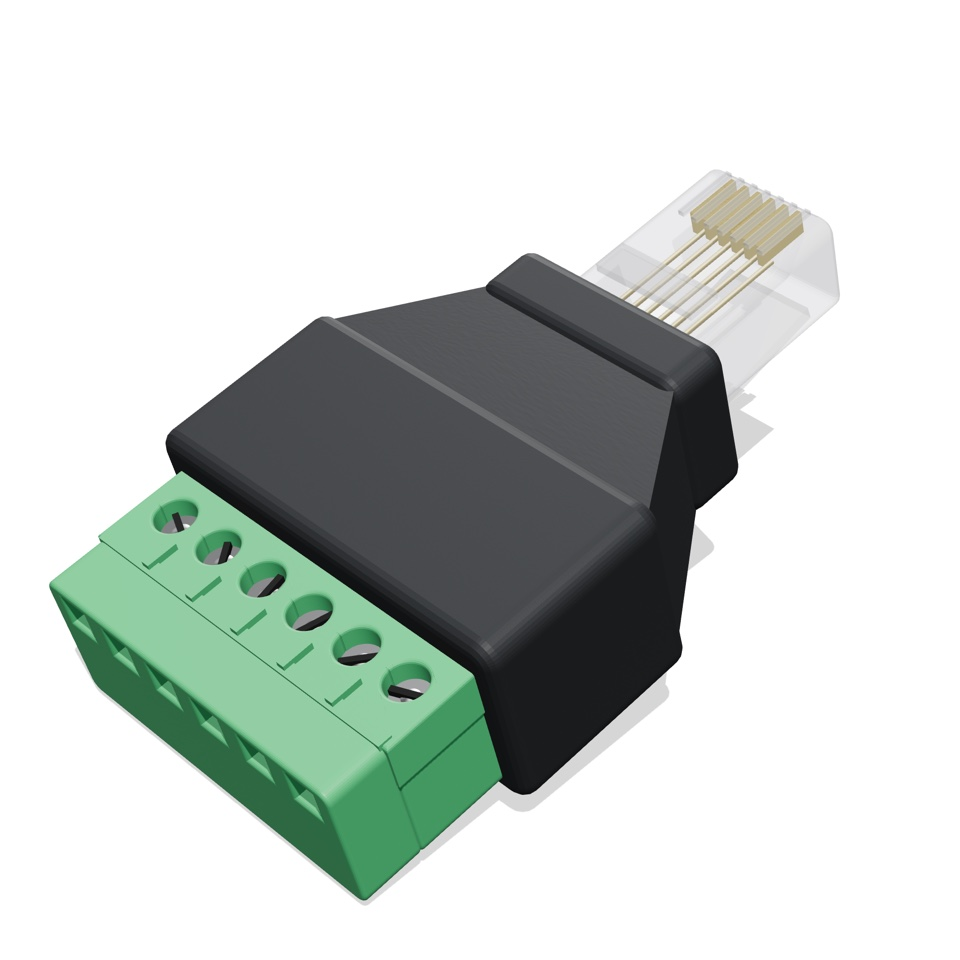

# Arcam Radia ESP32 Control

[](https://github.com/marenzo/arcam-radia-esp32-control/actions/workflows/ci.yml)
[](https://crates.io/crates/arcam-radia)
[](https://docs.rs/arcam-radia)
[](#license)
[](docs/integration.md)
[](docs/hardware.md#parts)

Turn your Arcam Radia A25 on and off, set the volume, mute it and switch
inputs from Home Assistant or any HTTP client, using a cheap ESP32 board
plugged into the amplifier's CONTROL jack.

> [!CAUTION]
> **This is a hobby project. Use it at your own risk.**
> It is not made, supported or endorsed by Arcam, and it has no affiliation
> with Arcam or its owners. It talks to your amplifier through a port Arcam
> never documented, and the amplifier's signal goes beyond the voltage an
> ESP32 pin is rated for ([details](#a-word-on-the-risk)). It comes with no
> warranty of any kind. If it damages your amplifier, your board or anything
> else, that is your responsibility, not mine. If you are not comfortable with
> that, don't connect it.

## Why I built this

I wanted my A25 to behave like part of the house: turn on with the TV, switch
to the right input, and let the house know what the amp is doing. My home system drives devices
through their own HTTP or RPC interfaces, and the A25 has neither. It has no
network port at all.

I started with infrared. IR only goes one way: you can send a command but you
never hear back, so the house can't tell whether the amp is on, which input
it's on or what the volume is. Its picture of the amp drifts away from the
real thing as soon as someone touches the remote.

On the back of the A25 there is a small RJ12 jack marked CONTROL. Arcam uses
it to let its own CD player and streamer operate the amp. Arcam doesn't
document it and, as far as I could find, nobody else had either. Arcam does
publish the amplifier's firmware, though, so I worked out the protocol from
it, for interoperability, and then tried the core commands on the real
amplifier. The [protocol page](docs/protocol.md) marks which details were
seen on the jack and which come only from the firmware. The jack speaks both
ways: you send a command and the amp tells you its state.

This repository is the result: firmware for an ESP32 that sits on that jack
and gives the amp a small HTTP API. I use it over HTTP from my own system. For
everyone else, it also connects to Home Assistant over MQTT, out of the box.

## What you get

- **Power, volume, mute and input** as Home Assistant entities, found
  automatically through MQTT discovery.
- **A simple HTTP API** (`GET /api/state`, `POST /api/command`), and a settings
  page on the device itself.
- **The real state of the amp.** Changes made with the remote or the knob show
  up in Home Assistant too ([how soon](#good-to-know)).
- **Prometheus metrics** and **firmware updates from the browser**.
- Wi-Fi setup from the browser, and a 3D wiring guide served by the device.

## How it works

The CONTROL jack is a serial port at 19200 baud. A request is four bytes
(`!`, a command, a value, a carriage return), and the amp answers with its
current value. Power, volume, mute, input and a model query are all there
is, apart from one DAC setting the bridge never touches.
The [protocol page](docs/protocol.md) has every byte, how I found it and
which parts are proven.

The amp's side uses RS-232 levels, which normally means a converter chip. Its
transmitter sleeps until it sees a signal, so the ESP32 pokes the line after
each request to wake it and listens for the reply. That's why plain wires
from two ESP32 pins are enough: no level shifter, no RS-232 chip, no
soldering if your board has a suitable connector. It also explains the
voltage caveat below.

## A word on the risk

While the amp replies, its line swings to about ±5.4 V. That figure is the
typical output of the RS-232 transceiver family the jack behaves like, taken
from its datasheet; I haven't measured it on the amp. An ESP32 pin is rated
for −0.3 to 3.6 V. On my bench the board has talked to the amp many times over
bare wire with no trouble. That still isn't a proper RS-232
interface, and nobody has tested it over months or years of use. The
firmware keeps each exposure as short as it can, and a series resistor may
help, but that is untested too. The [hardware notes](docs/hardware.md#electrical)
explain the electrical side. Read them before you plug anything in.

## What you need

- **An ESP32 board** with the original ESP32 chip (not an S2, S3 or C3: the
  firmware is built for the original), 4 MB of flash, and two free pins. The
  firmware uses GPIO32 to send and GPIO26 to receive. Other pins need a
  rebuild.
- **An RJ12 (6P6C) plug-to-screw-terminal adapter**, sold as an
  RJ12 breakout.
- **Three wires**, a **USB data cable** (not a charge-only one) and a
  **2.4 GHz Wi-Fi network**.

What I used: an [M5Stack Atom Lite](https://docs.m5stack.com/en/core/Atom-Lite),
because its Grove port already carries GPIO32 and GPIO26, so a Grove cable is
all the wiring it needs, and
[this RJ12 adapter](https://www.aliexpress.com/item/1005009667231706.html).
Any equivalent parts will do. The [hardware page](docs/hardware.md) has the
parts list and wiring.



## Setup

Keep the board unplugged from the amp until step 4.

1. **Get the firmware.** Download `arcam-radia-esp32-control.bin` from
   [Releases](https://github.com/marenzo/arcam-radia-esp32-control/releases).
   No release is published yet, so for now build it yourself. You only need
   [Docker](https://docs.docker.com/get-docker/):

   ```sh
   git clone https://github.com/marenzo/arcam-radia-esp32-control
   cd arcam-radia-esp32-control
   firmware/build.sh    # writes dist/arcam-radia-esp32-control.bin
   ```

   The first build downloads Espressif's toolchain and takes a while.
2. **Flash it.** Write the `.bin` at offset `0x0` with
   [Espressif's browser flasher](https://espressif.github.io/esptool-js/)
   (desktop Chrome or Edge), or run
   `espflash write-bin 0x0 arcam-radia-esp32-control.bin`. Close the flasher
   when it's done, because it keeps the USB port busy.
3. **Join your Wi-Fi.** Open [Improv via Serial](https://www.improv-wifi.com/)
   in the same browser, pick the board and enter your network. It gives you
   the device's address. Open it to see the settings page.
4. **Wire it to the amp.** Adapters number their terminals differently, so
   first [check which terminal is which](docs/hardware.md#identify-the-terminals).
   The device shows a step-by-step 3D guide at `http://<device address>/wiring`.
   Then plug it in and press **Refresh** on the settings page. You should see
   **Amplifier answered.**
5. **Use it.** HTTP works straight away:

   ```sh
   curl http://<device address>/api/state
   curl -X POST http://<device address>/api/command -d '{"volume":40}'
   ```

   For Home Assistant, enter your MQTT broker on the settings page, for
   example the Mosquitto add-on. The amp appears in the MQTT integration as
   `arcam-radia-XXXXXX`. The [integration guide](docs/integration.md) lists
   every entity, topic and API call, with an example automation that turns
   the amp on with the TV.

**Updating:** upload `arcam-radia-esp32-control-app.bin` under **Update
firmware** on the settings page. Wi-Fi and settings are kept. A new version
confirms itself once it's back on the network. If the board resets before
that, for example after a crash or a power cut, it boots the previous
version.

## Good to know

- **Changes at the amp show up after a short delay, not instantly.** The
  bridge can only hear the amp when it asks. Every question also restarts the
  amp's 20-minute auto-standby timer, so asking all the time would keep the
  amp on forever. For five minutes after anything changes, the bridge asks
  often, so a knob turn then shows up within about 2 seconds. After that it
  checks only every 21 minutes, which lets auto-standby do its job. A change
  made at the amp while things are quiet can take that long to appear.
  In standby it checks power every 5 seconds, so a power-on from the remote
  is seen almost at once. You can change this
  ([polling](docs/integration.md#polling)).
- **There's a volume ceiling,** 60 out of 99 by default, so a typo or a
  runaway automation can't blast your speakers. The amp itself has no limit.
  The firmware suggests some inputs keep their own volume, so after an
  input change the bridge checks the level and turns it down to the ceiling
  if needed. A level set by hand at the amp is left alone until then. Change
  the ceiling on the settings page.
- **Some commands are left out on purpose.** The bridge can't send the power
  *toggle*: if it guessed the state wrong, "on" would turn the amp off. It
  also can't send the command that changes the amp's stored DAC filter
  setting.
- **There's no password.** Anyone on your network can control the amp or
  replace the firmware, and MQTT travels unencrypted. Keep the device on a
  network you trust. The bridge does refuse requests that a web page on
  another site sends through your browser.

## Does it work with my amp?

| Amplifier | Firmware | |
|---|---|---|
| Radia A25 | V1.34 | works: my amplifier, with an Atom Lite and bare wire |
| Radia A15, A5 and other Radia models | | unknown |

On my A25 I've tested flashing and Wi-Fi setup in the browser, reading the
state, control over HTTP (including an input change), a command over MQTT,
and a firmware update over the network. Months of continuous use, and rollback after a failed update
on a real board, are still untested.

Other Radia models probably use the same jack, but their inputs and details
may differ. If you try one, please
[send a compatibility report](https://github.com/marenzo/arcam-radia-esp32-control/issues/new?template=compatibility.yml),
whether it works or not. If you use an AI coding agent, the repository
includes an `adapt-model` skill
([.claude/skills/adapt-model](.claude/skills/adapt-model/SKILL.md)). It walks
the agent through adding a model from a report, a capture or that model's
firmware, without guessing and without ever sending an unsafe command.

## Troubleshooting

| Problem | Try |
|---|---|
| The browser can't see the board | Use a USB *data* cable, and close any other flasher or serial monitor that holds the port. |
| Wi-Fi setup finished but the page won't open | Get the address again from Improv, or from the USB log at 115200 baud (`net: http://…/`). Make sure your computer is on the same network. |
| The page opens but the amp doesn't answer | Check the wiring against [the terminal guide](docs/hardware.md#identify-the-terminals). A crossed cable swaps send and receive. Then press Refresh again. |
| HTTP works but Home Assistant shows nothing | Check the broker address and login on the settings page, and that Home Assistant's MQTT integration is set up ([broker setup](docs/integration.md#broker)). |

## More

- [docs/](docs/README.md): the documentation guide, covering hardware,
  integration and the protocol.
- [AGENTS.md](AGENTS.md): building, testing and conventions, for contributors
  and their coding agents.
- [emulator/](emulator/README.md): a virtual A25 that runs the real firmware
  end to end, with no hardware.
- [core/](core/README.md): the protocol as a small, dependency-free Rust
  library, the `arcam-radia` crate.
- [CHANGELOG.md](CHANGELOG.md): what changed in each release. Version 0.1.0
  is in preparation.

## License

The code is [MIT](LICENSE). The documentation and captures are
[CC BY 4.0](docs/LICENSE). The bundled 3D viewer has its own terms, listed
there. This repository contains no Arcam firmware. Arcam and Radia are
trademarks of their respective owners. Their use here only describes
compatibility.
