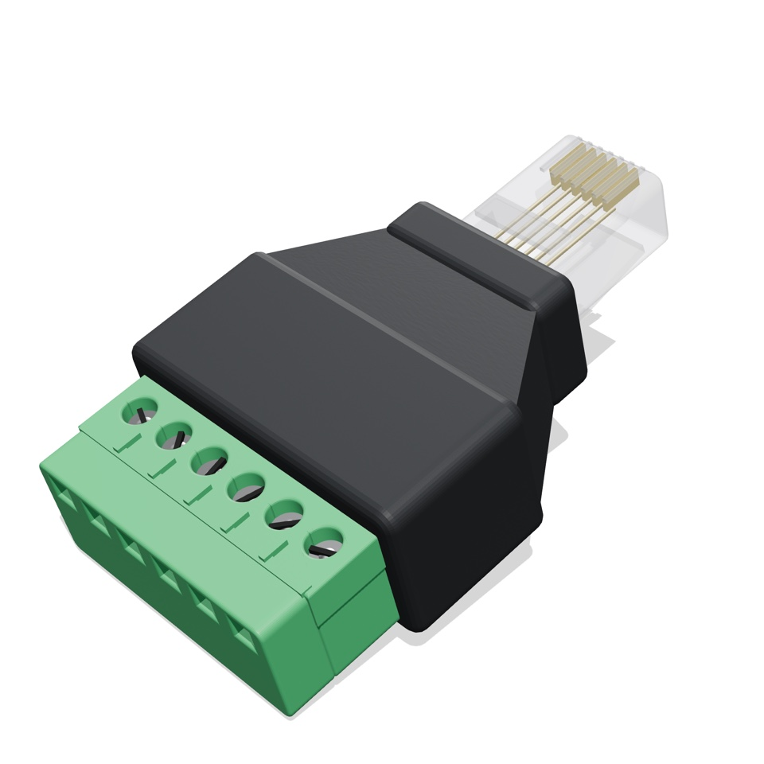

# Hardware

This page describes the experimental A25 / Atom Lite bench. The amplifier's
transmit voltage exceeds the ESP32 receive pin rating. The maintainer tested
repeated communication with bare wire. The resistor variants are untested. Read the
[electrical discussion](#electrical) before attempting a build.

## Parts

| Part | Notes |
|---|---|
| An ESP32 board | The original ESP32 with 4 MB flash, with GPIO32 and GPIO26 free. Tested: [M5Stack Atom Lite](https://docs.m5stack.com/en/core/Atom-Lite), whose Grove port carries both pins |
| RJ12 6P6C plug to 6-screw-terminal adapter | Plugs into the CONTROL jack, [for example this one](https://www.aliexpress.com/item/1005009667231706.html). A socket-type adapter needs a short straight RJ12 cable as well |
| Three wires | A Grove cable on an Atom Lite, jumpers otherwise |
| Series resistor | Untested variation. See [Electrical](#electrical) |
| USB 5 V supply | |



A rendering of a generic adapter ([source](wiring/adapter.html)). Terminal
numbering and colours vary between makers.

## Wiring

The amplifier's jack is 6P4C: only the middle four contacts exist. Terminal
numbers refer to the bench adapter. [Check your adapter first](#identify-the-terminals).

| Terminal | Amplifier | ESP32 | Atom Lite Grove |
|---|---|---|---|
| 1, 6 | no contact | | |
| 2, 5 | ground (one net) | GND, to terminal 5 | black |
| 3 | receive (about 5 kΩ to ground) | GPIO32, the ESP's TX | white |
| 4 | transmit | GPIO26, the ESP's RX, bare wire on the bench | yellow |
| | | leave 5 V unconnected | red: tape it off |

```
  adapter                ESP32
  1  (no contact)
  2  (ground, joined to 5)
  3 ------------------- GPIO32  TX
  4 ------------------- GPIO26  RX
  5 ------------------- GND
  6  (no contact)
```

Other pins need a firmware build: they are constants in `firmware/src/main.rs`.
The device shows the same wiring as a 3D guide at `http://<device address>/wiring`
([guide.html](wiring/guide.html)).

## Identify the terminals

Trace the detached adapter and cable from screw to plug contact before
connecting either device. Use their pinout or check continuity on the loose
assembly with both ends disconnected. A reversed cable swaps the middle
pair. If the orientation or contact mapping is uncertain, stop before wiring.

The research bench identified the amplifier terminals with ESP32 pull
resistors and ADC readings, as described below. The approximately 5 kΩ
receiver load is an inference from that experiment. A meter procedure on the
amplifier jack has not been verified.

### Probing with an ESP32

The jack's levels were unknown and no meter was at hand, so the ESP32
measured the jack before any pin was driven:

- An internal pull-up or pull-down plus the ADC is a rough meter: a terminal
  that reads 0.33 V under the pull-up is a load of about 5 kΩ; an open one
  reads near the rail.
- Floating inputs pick up mains hum, which a UART reads as bytes (`fe`, the
  `rx` line of the [capture](protocol.md#captures)). Stray edges are not data.
- Take a verdict from several consecutive readings: a single contact bounce
  fooled a first plug-in detector.
- Two grounds, one 5 kΩ input and one output that stays high impedance until
  the input is driven: the signature of an RS-232 transceiver with
  auto-powerdown.

RS-232 puts a negative voltage on the pin, so keep the amplifier undriven until
the contacts are known, and keep each exposure short
([the risk](#the-risk-and-the-resistor)).

## Electrical

The jack behaves like RS-232 behind a transceiver with auto-powerdown, such
as the 3221 family. That is an inference from probing it
([above](#probing-with-an-esp32)) and from the firmware, not a part number
read off the board. Its receiver always listens. Its driver sleeps (high impedance) until the
receiver sees a valid level, beyond about ±2.7 V, and once awake idles
negative. An ESP32 pin cannot go negative, so the firmware:

- runs the UART at 19200 8N1 with both lines inverted: transmit idles at 0 V,
  which the receiver reads as idle, and 3.3 V reads as a zero bit;
- holds transmit at 3.3 V after each request. That wakes the amplifier's
  driver so it can answer; the amplifier's UART reads the hold as a break and
  ignores it;
- enables the receive pin's pull-down, so a sleeping (floating) driver and an
  awake (negative) one both read as idle;
- sets transmit to the weakest drive strength.

The reply comes 0 to 50 ms after the request
([protocol](protocol.md#timing)), so the hold must cover 50 ms; shorter holds
lose replies. The firmware holds for up to 150 ms and lets go two character
times after the reply, typically about 30 ms after the request.

The cost of this is that the bridge hears the amplifier only inside its own
holds. Changes made at the knob, remote or front panel are seen at the next
query ([polling](integration.md#polling)).

### The risk, and the resistor

While its driver is awake, terminal 4 idles negative and swings positive.
For that transceiver family the datasheet gives a typical swing of about
±5.4 V. This was not measured on the amplifier. Either way it is beyond an
ESP32 pin's -0.3 V to 3.6 V. The pin's clamp diodes conduct
during a reply. Firmware releases the hold early to shorten the exposure.
Repeated communication was observed on one board. Long-term reliability and
a protected interface remain unqualified.

For a proposed 10 kΩ series resistor in the receive wire, a negative swing
of 5.4 V and an assumed 0.6 V clamp drop give about 0.48 mA. The proposed
4.7–22 kΩ range has no bench results. Larger values also divide the signal
against the internal pull-down (roughly 45 kΩ).

## Ground hum

Untested: whether a USB-powered board causes hum through the signal ground
while the amplifier plays. If you hear it, try another supply (a battery bank
is a quick test) and report it.
